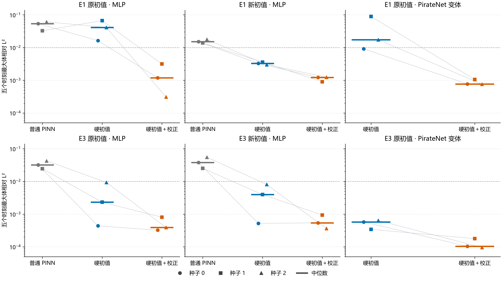
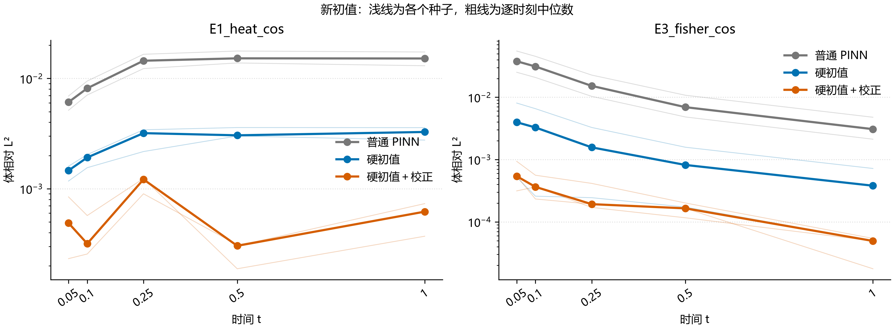

# R33 第一阶段结果分析与论文证据整理

整理时间：2026-10-22T21:47:11.591101+08:00。本报告由保存结果自动汇总，新增分析为事后描述性分析。

**判断：值得继续完成一篇范围明确的方法论文初稿，并优先补 τ 灵敏度；当前不建议启动大规模调参。** 第一阶段回答了 E1 PirateNet 是否可叠加、换初值后是否仍有收益两项问题，但没有证明任意初值、任意优化器或所有种子上都更好。A-1、G2 和 E4 的负面结论保持原样。

## 1. 完成状态与数据可信度

第一阶段于 2026-10-22 13:51:32 UTC+8 启动、2026-10-22 20:07:28 UTC+8 完成，实测 6.27 小时。四个 PirateNet 按原 checkpoint 续跑、18 个新初值任务完整训练；22/22 完整产物身份/哈希及原设置与 N96/GL400 误差复算均通过。

本次重新核对全部 176 个结果 JSON 与对应权重，共 398 个原始结果文件；旧 260 文件 SHA256 未变。新增 22 份 JSON 与验证时哈希一致，训练源代码仍匹配开跑工程门。这里复用已通过的模型加载与数值重算，并独立检查哈希、聚合及加密误差容差；没有重复训练。

新结果原/加密误差序列最大绝对差：体 1.522e-11、迹 2.768e-11。新初值参考解 N48/N96 差分别为 8.663e-13、5.881e-13，E1 独立本征展开差为 6.873e-13。这些参考核验覆盖五个既定时刻，不扩展到 t→0。

| tag | JSON | base PT | 完整 model PT |
| --- | --- | --- | --- |
| axis | 36 | 36 | 0 |
| causal1 | 6 | 6 | 0 |
| causal10 | 6 | 6 | 0 |
| confirm | 24 | 24 | 0 |
| e4confirm | 12 | 12 | 0 |
| e4screen | 8 | 8 | 0 |
| final_ic_v1 | 18 | 18 | 18 |
| pirate | 12 | 12 | 4 |
| preflight4_adam | 12 | 12 | 12 |
| preflight4_soap64 | 12 | 12 | 12 |
| screen | 30 | 30 | 0 |
| soap1e3 | 0 | 0 | 0 |
| soap3e3 | 0 | 0 | 0 |
| ic1000 | 0 | 0 | 0 |

其中 preflight4 的 24 次为独立种子 100/101 的小预算投入检查，不进入正式主表；旧 E4 的 20 个 PT 缺表面分支，表面 v(t) 不列为可复现定量证据。旧三个零结果 tag 仍为空；本轮没有调参结果，也没有可以填写的‘调参后对调参后’表。

## 2. 主指标、统计口径与全种子对照

主指标是每个种子在 t={0.05,0.1,0.25,0.5,1} 五个时刻上的最大体相对 L²，再对种子 0/1/2 取中位数。改善倍数为两方法中位数之比，**不是配对比值的中位数，也不是连续时间最大误差**。小样本仅作描述性比较；不使用显著性措辞或把 3/3 当成总体成功概率。

| 问题 / 架构 | vanilla ÷ 校正 | hardic ÷ 校正 | 配对改善种子 | 配对比（s0/s1/s2） |
| --- | --- | --- | --- | --- |
| E1_heat / MLP | 45.47 | 34.83 | 3/3 | 13.824 / 21.067 / 133.496 |
| E3_fisher / MLP | 81.60 | 5.92 | 3/3 | 1.355 / 2.886 / 23.834 |
| E1_heat / PirateNet 变体 | 未在本架构比较 | 22.61 | 3/3 | 11.858 / 84.890 / 22.876 |
| E3_fisher / PirateNet 变体 | 未在本架构比较 | 5.52 | 3/3 | 5.518 / 1.911 / 6.697 |
| E1_heat_cos / MLP | 12.53 | 2.69 | 3/3 | 2.692 / 3.990 / 2.429 |
| E3_fisher_cos / MLP | 69.96 | 7.34 | 2/3 | 0.966 / 4.241 / 22.151 |

四个 MLP 配置（原/新初值 × E1/E3）的三种子中位数均改善；12 个配对种子中 11 个改善。原初值的两个 PirateNet 配置共 6 个配对种子均改善。这些计数仅描述当前样本，不把相关配置合并成新的统计检验。

图中点为全部种子，短横线为中位数，连线只对应相同种子；纵轴为对数。1e−2 线仅为原协议报告阈值，不是发表标准。

### 2.1 新初值的完整对照

| 问题 | 方法 | seed 0 | seed 1 | seed 2 | 体误差中位数 | 迹误差中位数 | 体≤1e−2 |
| --- | --- | --- | --- | --- | --- | --- | --- |
| E1_heat_cos | 普通 PINN | 1.5219e-02 | 1.3820e-02 | 1.7728e-02 | 1.5219e-02 | 1.5005e-02 | 0/3 |
| E1_heat_cos | 硬初值 | 3.2704e-03 | 3.5871e-03 | 3.0063e-03 | 3.2704e-03 | 3.7079e-03 | 3/3 |
| E1_heat_cos | 硬初值＋校正 | 1.2149e-03 | 8.9913e-04 | 1.2377e-03 | 1.2149e-03 | 6.6615e-04 | 3/3 |
| E3_fisher_cos | 普通 PINN | 3.7809e-02 | 2.5163e-02 | 5.5157e-02 | 3.7809e-02 | 8.1752e-02 | 0/3 |
| E3_fisher_cos | 硬初值 | 5.2185e-04 | 3.9694e-03 | 8.0673e-03 | 3.9694e-03 | 9.1083e-03 | 3/3 |
| E3_fisher_cos | 硬初值＋校正 | 5.4048e-04 | 9.3602e-04 | 3.6419e-04 | 5.4048e-04 | 3.1357e-04 | 3/3 |

E1 新初值：hardic+layer 三个种子均优于 hardic，中位数收益 2.69 倍，低于原初值的 34.83 倍。新初值没有预注册三倍通过门，因此不能把这一结果重新包装成‘达标’或‘失败’；它说明收益随问题配置变化。

E3 新初值：中位数收益 7.34 倍，但 seed 0 的体误差由 5.2185e−4 变为 5.4048e−4，增加约 3.57%；同种子的迹误差仍下降。seed 1/2 的体误差明显降低。该组收益主要体现为较差种子误差减轻；不能声称逐种子一致改善或已证明训练稳定性的总体提升。

### 2.2 PirateNet 补齐与原判据

| 问题 | 方法 | seed 0 | seed 1 | seed 2 | 中位数 |
| --- | --- | --- | --- | --- | --- |
| E1_heat | 硬初值 | 9.1237e-03 | 8.9450e-02 | 1.7395e-02 | 1.7395e-02 |
| E1_heat | 硬初值＋校正 | 7.6944e-04 | 1.0537e-03 | 7.6044e-04 | 7.6944e-04 |
| E3_fisher | 硬初值 | 5.7394e-04 | 3.4149e-04 | 6.4031e-04 | 5.7394e-04 |
| E3_fisher | 硬初值＋校正 | 1.0402e-04 | 1.7868e-04 | 9.5611e-05 | 1.0402e-04 |

A-2 按原规则更新为 E1/E3 均满足：22.61/5.52 倍。只完成了此前缺失的 E1 判定，没有改门槛。PirateNet 名称须注明实际使用的是省略物理信息最小二乘初始化的变体；本机续跑保持原任务身份，不声称跨机器训练轨迹逐位一致。

| A-1 问题 | 较好因果中位数 | PirateNet hardic 中位数 | 最好基线 | 最好基线 ÷ MLP校正 | ≥3 |
| --- | --- | --- | --- | --- | --- |
| E1_heat | 1.4763e-02 | 1.7395e-02 | causal10 | 12.507 | 是 |
| E3_fisher | 1.1088e-03 | 5.7394e-04 | pirate | 1.466 | 否 |

A-1 仍整体不满足，E3 为 1.47 倍；修订 4 的 G2 仍未通过。E4 对 vanilla 的中位数比约 0.838，修正没有显示优势；E3 κ=0.1 的修正误差约高 38%。这些反例必须保留。

## 3. 时间分布与独立残差

下表是各时刻体误差的三种子中位数，与‘各种子先取最大值再取中位数’的主指标不同。

| 新初值 | 方法 | t=0.05 | t=0.1 | t=0.25 | t=0.5 | t=1 |
| --- | --- | --- | --- | --- | --- | --- |
| E1_heat_cos | 普通 PINN | 6.0946e-03 | 8.1441e-03 | 1.4476e-02 | 1.5219e-02 | 1.5171e-02 |
| E1_heat_cos | 硬初值 | 1.4619e-03 | 1.9192e-03 | 3.1915e-03 | 3.0493e-03 | 3.2704e-03 |
| E1_heat_cos | 硬初值＋校正 | 4.8884e-04 | 3.1757e-04 | 1.2149e-03 | 3.0354e-04 | 6.1937e-04 |
| E3_fisher_cos | 普通 PINN | 3.7809e-02 | 3.1138e-02 | 1.5212e-02 | 6.9272e-03 | 3.0771e-03 |
| E3_fisher_cos | 硬初值 | 3.9694e-03 | 3.2698e-03 | 1.5684e-03 | 8.1887e-04 | 3.8047e-04 |
| E3_fisher_cos | 硬初值＋校正 | 5.4048e-04 | 3.6419e-04 | 1.9236e-04 | 1.6476e-04 | 4.9394e-05 |

独立检验点沿用修订 5：固定 RNG 330500，体 8192 点、各边界 1024 点、初值 1024 点；时间均匀分布在 [1e−4,1]。下表是各分量 RMS 的种子中位数，点未参与训练或选参。不同分量没有统一归一化，不直接混成一个排名。

| 新初值 | 方法 | PDE RMS | 左 Neumann RMS | 右动态边界 RMS | 初值 RMS |
| --- | --- | --- | --- | --- | --- |
| E1_heat_cos | 普通 PINN | 1.2000e-03 | 3.1921e-04 | 7.0506e-04 | 1.3442e-03 |
| E1_heat_cos | 硬初值 | 8.6070e-03 | 3.1867e-04 | 1.7971e-03 | 0.0000e+00 |
| E1_heat_cos | 硬初值＋校正 | 1.8907e-03 | 3.3734e-04 | 8.0618e-04 | 0.0000e+00 |
| E3_fisher_cos | 普通 PINN | 1.7452e-03 | 4.9809e-04 | 1.2014e-03 | 2.4086e-03 |
| E3_fisher_cos | 硬初值 | 2.3280e-03 | 1.4183e-04 | 1.6238e-03 | 0.0000e+00 |
| E3_fisher_cos | 硬初值＋校正 | 1.0496e-03 | 1.3784e-04 | 3.0663e-04 | 0.0000e+00 |

PDE 残差与解误差并不总同序：E1 新初值的 vanilla 的 PDE RMS 中位数低于修正方法，但其体误差更高且初值不精确。这表明单看 PDE 残差会遗漏初值/边界误差影响，不能把较小训练损失或某个单项残差直接当成更准确的解。当前没有据残差或参考解重新选配置。

相对 hardic，修正的 PDE RMS 中位数在两个新初值上都降低；右边界也有中位数改善，但 E1 seed 0 的右动态边界 RMS 由 7.8475e−4 升到 8.0618e−4（约 +2.73%）。修正仅精确满足初值，不保证全域 PDE/边界残差处处改善或为零。

本次五个评价时刻从 0.05 开始；独立残差采用均匀时间点。它们不足以刻画非常薄的 t→0 角点层，也没有证明 δ 为收益的唯一原因。若论文强化机制解释，应先核早期参考解分辨率，再对已保存模型作独立的早期时空诊断。

## 4. 实际计算量与墙钟解释

本机批次墙钟：PirateNet 四次续跑及复核约 2.54 小时；18 次新初值及复核约 3.73 小时。新初值累加进程耗时 26.10 小时，单次 38.2–103.5 分钟、中位数 90.4 分钟；并行进程耗时之和不等于整机完成时间或 CPU 核时。

18:54 因用户报告卡顿，八个训练进程从 Normal 降为 BelowNormal，模型/训练配置未改。末尾两个任务开始时并发负载较低，其耗时明显短于早期任务。不能由这批异负载墙钟推出固定百分比额外开销、同时间优势或硬件无关速度排名。PirateNet JSON 的 wall_seconds 包含此前云端保存的训练历史，也不能当作本机续跑时长。

22 个新完成任务均沿用 Adam 20000 调用的总轨迹和 L-BFGS 3000 的名义预算；恢复任务只补剩余 Adam。实际 L-BFGS 内部迭代为 1951–3000，closure 为 3196–3751。下面保留实际计数。名义预算用满不意味着内部 n_iter 恰好等于 3000，也不证明达到全局最优或充分收敛。

| 任务 | seed | Adam恢复点 | L-BFGS 内部迭代 | closure | 停止原因 | 轨迹墙钟/分钟 |
| --- | --- | --- | --- | --- | --- | --- |
| E1_heat / hardic | 0 | adam:1000; adam:14000; adam:16500 | 2799 | 3472 | budget_exhausted | 454.2 |
| E1_heat / hardic+layer | 0 | adam:1000; adam:13500; adam:16000 | 1951 | 3751 | budget_exhausted | 458.3 |
| E1_heat / hardic | 1 | adam:1000; adam:14000; adam:16500 | 3000 | 3314 | budget_exhausted | 450.9 |
| E1_heat / hardic+layer | 1 | adam:1000; adam:13500; adam:16000 | 3000 | 3379 | budget_exhausted | 452.5 |
| E1_heat_cos / vanilla | 0 | 从头 | 3000 | 3222 | budget_exhausted | 87.2 |
| E1_heat_cos / hardic | 0 | 从头 | 3000 | 3232 | budget_exhausted | 85.4 |
| E1_heat_cos / hardic+layer | 0 | 从头 | 3000 | 3277 | budget_exhausted | 90.2 |
| E3_fisher_cos / vanilla | 0 | 从头 | 3000 | 3282 | budget_exhausted | 87.3 |
| E3_fisher_cos / hardic | 0 | 从头 | 3000 | 3261 | budget_exhausted | 86.5 |
| E3_fisher_cos / hardic+layer | 0 | 从头 | 2936 | 3410 | budget_exhausted | 90.5 |
| E1_heat_cos / vanilla | 1 | 从头 | 3000 | 3196 | budget_exhausted | 86.9 |
| E1_heat_cos / hardic | 1 | 从头 | 3000 | 3281 | budget_exhausted | 85.7 |
| E1_heat_cos / hardic+layer | 1 | 从头 | 3000 | 3287 | budget_exhausted | 99.3 |
| E3_fisher_cos / vanilla | 1 | 从头 | 3000 | 3216 | budget_exhausted | 96.7 |
| E3_fisher_cos / hardic | 1 | 从头 | 3000 | 3283 | budget_exhausted | 97.5 |
| E3_fisher_cos / hardic+layer | 1 | 从头 | 2694 | 3433 | budget_exhausted | 103.5 |
| E1_heat_cos / vanilla | 2 | 从头 | 3000 | 3225 | budget_exhausted | 96.3 |
| E1_heat_cos / hardic | 2 | 从头 | 3000 | 3233 | budget_exhausted | 95.9 |
| E1_heat_cos / hardic+layer | 2 | 从头 | 3000 | 3239 | budget_exhausted | 100.2 |
| E3_fisher_cos / vanilla | 2 | 从头 | 3000 | 3278 | budget_exhausted | 98.3 |
| E3_fisher_cos / hardic | 2 | 从头 | 2604 | 3457 | budget_exhausted | 38.2 |
| E3_fisher_cos / hardic+layer | 2 | 从头 | 2457 | 3555 | budget_exhausted | 40.1 |

新初值的共享架构、种子集合、采样规则、优化调用上限均一致，τ=0.1，零调参。损失中初值的处理是方法差别：vanilla 为软损失，hardic 类为解析约束。旧 RBA 的 L-BFGS 固定体点 4096，普通方法 8192，应披露，不能据同一上限声称相同实际计算量。所有损失、逐时刻指标、计数、残差及来源路径见 all_runs.csv；未保存项留空，未补造旧计数。

## 5. 论文可写内容与证据缺口

| 拟写论点 | 当前判断 | 证据/边界 |
| --- | --- | --- |
| 在被测一维动态边界问题上改善普通 PINN 和硬初值 | 支持经验性表述 | 四个 MLP 问题/初值配置中位数均改善；逐种子有一个体误差反例 |
| 可叠加到所用 PirateNet 变体 | 支持限定表述 | 原 E1/E3 均按 A-2 达到三倍，完整三种子 |
| 换初值仍有效 | 支持两个预先固定新初值 | 训练分别重做；不是一个网络泛化到未训练初值，也不是任意初值保证 |
| 基于经典角点层分析的修正 | 可写构造与消融 | 完整经典来源逐式对照仍需完成；不称首次或全新数学原理 |
| 对 τ 鲁棒或无参数 | 证据不足 | 目前 τ 固定 0.1；没有灵敏度结果 |
| 优化器无关或普遍强于现代 PINN | 不支持 | A-1/G2 失败；正式完整 SOAP64 尚未做 |
| 更省计算/稳定性有统计保证 | 不支持 | 异负载墙钟、实际调用不同；各配置只有三个种子 |
| 已具备正式投稿完成度 | 尚未 | 需来源、稿件、图表、复现包及目标期刊要求闭合；没有录用保证 |

建议结果章节顺序：原初值主表 → 新初值及同架构消融 → PirateNet 叠加 → 参数范围与失败例 → 残差及计算成本。主文保留负面结果入口，附录给全部种子；不把各方程/初值/架构拼成一项胜率或总体统计显著结论。文献定位沿用已整理的七篇原文选读，本轮不声称新增文献核验。

可直接用于初稿的结果表述：在固定训练预算下，基于经典角点层分析的修正在所测 E1/E3 的原初值和预先指定的新初值中降低了三种子体误差中位数；新初值相对硬初值的比值为 2.69 和 7.34。该修正可叠加到本文采用的 PirateNet 变体，在原 E1/E3 上的比值为 22.61 和 5.52。收益依赖问题和种子，E3 新初值的一个种子体误差略升，弱错配参数点及 E4 存在负面结果。

## 6. 后续投入建议（草案，未启动）

第一优先：整理方法推导出处、主表/附录与明确范围的初稿，同时补 12 次 τ 灵敏度。这一问题直接决定‘固定 τ=0.1 的效果是否过于偶然’，比大规模调参更贴近当前论文缺口。原 E1/E3，hardic+layer，τ∈{0.03,0.3}，种子 0/1/2，完整共享预算；与旧 τ=0.1 全部并列。保持主配置 0.1，不按误差选最佳 τ；因此是敏感性描述，不是专门给候选方法挑配置。若据此换主配置，必须改走所有方法同预算的独立种子调参流程。

第二优先：只有决定在正文增加优化器叠加论点时，再做 18 次固定 SOAP 官方语义 float64 对照：原 E1/E3 × vanilla/hardic/hardic+layer × 种子 0/1/2，lr0=0.001，其余共享完整预算，零搜索。须用新 tag，不能冒充旧 soap1e3/soap3e3；小预算 G2 失败仍保留。

τ 批次按本次单任务范围估算，八进程预留约 3–5 小时；SOAP64 尚无本机完整预算实测，保留 4–8 小时规划区间。两者是宽松资源预算，不是性能预测或承诺；若为前台流畅降低并发，时间可能增加。执行前另行追加并提交协议，不能用本分析充当预注册。当前第二阶段未获授权，未运行任何新训练。

不建议恢复 42 个旧基线或 322 次调参草案；无需为了满足旧强排名主张增加搜索。τ 若高度敏感，先如实写范围；SOAP 若没有叠加收益，也只收窄优化器论点，不删结果、不改原判据。

## 7. 数据与复现入口

- 汇总代码：validation/stage5_analysis_20261022/analyze_stage5.py（只读原始结果）。
- 完整行表：validation/stage5_analysis_20261022/all_runs.csv；覆盖所有 tag，按 tag 区分筛选、正式比较及小预算检查。
- 计算与哈希证据：validation/stage5_analysis_20261022/analysis_evidence.json；结束状态归档为 completion_status_snapshot.json，可脱离本机运行目录复算。
- 原始本轮复核：validation/stage5_20261022/{pirate_validation,ic_validation,completion}.json。
- 图：同目录 300 dpi PNG 及矢量 PDF；图上显示全部种子，没有置信区间或模拟数据。
- 操作系统优先级调整：validation/stage5_20261022/priority_change_20261022.json。
- 历史协议、数据和判据保留；本报告仅更新完成状态及已注册 A-2 的最终判定。
