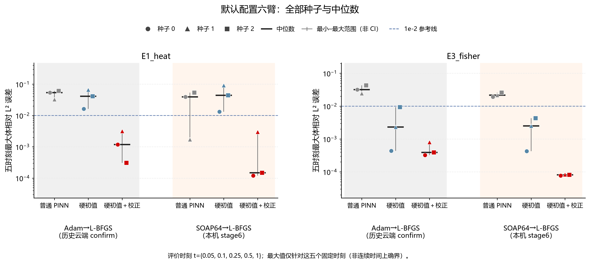
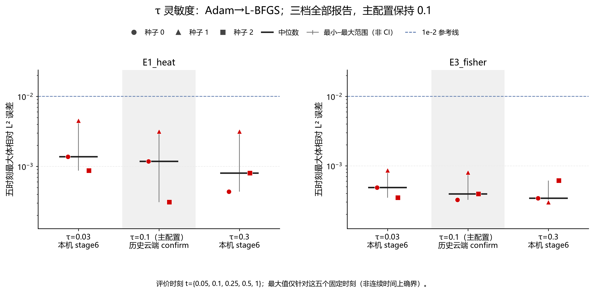

# R33 第二阶段完整结果分析

生成时间：2026-10-23T06:50:32.829209+08:00。状态：**30/30 已完成并绑定复核证据**。

S6-SOAP：**满足本批叠加判据**。该判据只描述本批固定配置，不是论文发表门槛。

所有新任务、所有种子和所有 τ 档均报告；主配置保持 τ=0.1，没有倒选 τ 或优化器。原 A-1、G2 失败和 E4 负面结果保留。

## 数据核验与范围

旧 398 个文件逐一 hash 不变；新增 30 项共 90 个原始文件均与完整模型验证报告绑定。原 N64/GL200 与加密 N96/GL400 的序列容差为 rtol=1e-5、atol=1e-9。独立残差沿用固定检验点；本分析只聚合既有报告，不追加模型诊断。

主指标为 t={0.05, 0.1, 0.25, 0.5, 1} 五个固定评价时刻的体相对 L² 误差最大值，不是连续时间上的上确界。

默认 Adam 来自历史云端 confirm，固定 SOAP64 来自本机本批；误差按已固定指标并列，但这不是隔离运行环境差异的优化器因果比较。不能把全部精度差异归因于优化器，也不能混为等墙钟或速度收益。同一本机环境内的 SOAP 三臂叠加判据另行判断。旧残差和未保存的实际调用留空。

## 默认配置六臂对照

每个方程给出 Adam→L-BFGS / SOAP64→L-BFGS × 普通 PINN/硬初值/硬初值加校正的三个真实报告种子。没有调参后主表。

| 方程 | tag | 方法 | 来源 | seed0 | seed1 | seed2 | 中位数 | 最小–最大 | ≤1e-2 |
| --- | --- | --- | --- | --- | --- | --- | --- | --- | --- |
| E1_heat | confirm | vanilla | 历史云端 confirm | 0.053672 | 0.032573 | 0.061017 | 0.053672 | 0.032573–0.061017 | 0/3 |
| E1_heat | confirm | hardic | 历史云端 confirm | 0.016318 | 0.0665 | 0.041114 | 0.041114 | 0.016318–0.0665 | 0/3 |
| E1_heat | confirm | hardic+layer | 历史云端 confirm | 0.0011804 | 0.0031566 | 0.00030798 | 0.0011804 | 0.00030798–0.0031566 | 3/3 |
| E1_heat | final_soap64_v1 | vanilla | 本机 stage6 | 0.03911 | 0.0017143 | 0.053669 | 0.03911 | 0.0017143–0.053669 | 1/3 |
| E1_heat | final_soap64_v1 | hardic | 本机 stage6 | 0.013263 | 0.091041 | 0.044305 | 0.044305 | 0.013263–0.091041 | 0/3 |
| E1_heat | final_soap64_v1 | hardic+layer | 本机 stage6 | 0.00012082 | 0.0029768 | 0.00014765 | 0.00014765 | 0.00012082–0.0029768 | 3/3 |
| E3_fisher | confirm | vanilla | 历史云端 confirm | 0.031945 | 0.024495 | 0.04261 | 0.031945 | 0.024495–0.04261 | 0/3 |
| E3_fisher | confirm | hardic | 历史云端 confirm | 0.00043798 | 0.0023164 | 0.0093311 | 0.0023164 | 0.00043798–0.0093311 | 3/3 |
| E3_fisher | confirm | hardic+layer | 历史云端 confirm | 0.00032335 | 0.00080274 | 0.0003915 | 0.0003915 | 0.00032335–0.00080274 | 3/3 |
| E3_fisher | final_soap64_v1 | vanilla | 本机 stage6 | 0.019065 | 0.021497 | 0.025762 | 0.021497 | 0.019065–0.025762 | 0/3 |
| E3_fisher | final_soap64_v1 | hardic | 本机 stage6 | 0.000426 | 0.0024948 | 0.0042854 | 0.0024948 | 0.000426–0.0042854 | 3/3 |
| E3_fisher | final_soap64_v1 | hardic+layer | 本机 stage6 | 7.7115e-05 | 8.3433e-05 | 8.0925e-05 | 8.0925e-05 | 7.7115e-05–8.3433e-05 | 3/3 |

图注：最终误差对应 Adam→L-BFGS 或 SOAP64→L-BFGS 完整训练路线。纵轴为 t={0.05, 0.1, 0.25, 0.5, 1} 五个固定评价时刻的最大体相对 L² 误差，非连续时间上确界。历史云端与本机来源分别标示。

## τ 灵敏度（不选参）

τ=0.03/0.3 为本机新增，τ=0.1 只读复用历史云端 confirm。各档保持完整预算与种子集合；与τ=0.1的差异同时包含运行环境差异，不能视为完全隔离环境后的τ因果效应。跨档 max/min 是中位数之比，不是置信区间或稳健性达标线。

| 方程 | τ | 来源 | seed0 | seed1 | seed2 | 中位数 | 范围 | 中位数/τ=0.1 |
| --- | --- | --- | --- | --- | --- | --- | --- | --- |
| E1_heat | 0.03 | 本机 stage6 | 0.0013733 | 0.0045109 | 0.00086808 | 0.0013733 | 0.00086808–0.0045109 | 1.1635 |
| E1_heat | 0.1 | 历史云端 confirm | 0.0011804 | 0.0031566 | 0.00030798 | 0.0011804 | 0.00030798–0.0031566 | 1 |
| E1_heat | 0.3 | 本机 stage6 | 0.00043487 | 0.0031508 | 0.0008004 | 0.0008004 | 0.00043487–0.0031508 | 0.67809 |
| E3_fisher | 0.03 | 本机 stage6 | 0.00048564 | 0.00086276 | 0.00034612 | 0.00048564 | 0.00034612–0.00086276 | 1.2405 |
| E3_fisher | 0.1 | 历史云端 confirm | 0.00032335 | 0.00080274 | 0.0003915 | 0.0003915 | 0.00032335–0.00080274 | 1 |
| E3_fisher | 0.3 | 本机 stage6 | 0.00033955 | 0.0002985 | 0.00061279 | 0.00033955 | 0.0002985–0.00061279 | 0.8673 |

| 方程 | 跨 τ 最大/最小中位数 | 主 τ |
| --- | --- | --- |
| E1_heat | 1.7158 | 0.1 |
| E3_fisher | 1.4303 | 0.1 |

图注：全部 τ 档采用 Adam→L-BFGS，主配置仍为 τ=0.1。纵轴为 t={0.05, 0.1, 0.25, 0.5, 1} 五个固定评价时刻的最大体相对 L² 误差，非连续时间上确界。τ=0.1 与其余两档的运行环境不同，图中差异不作隔离环境后的因果解释。

## S6-SOAP 预注册判定

两个方程均需 hardic 中位数至少为修正组 3 倍，且修正组至少 2/3 主误差≤1e-2。

| 方程 | hardic中位数 | 修正中位数 | 比值 | 修正≤1e-2 | 判定 |
| --- | --- | --- | --- | --- | --- |
| E1_heat | 0.044305 | 0.00014765 | 300.07 | 3/3 | 满足 |
| E3_fisher | 0.0024948 | 8.0925e-05 | 30.828 | 3/3 | 满足 |

## 全部新增任务的损失、独立残差和实际调用

训练损失受参数化与目标项影响，不能直接当成相同物理误差。final_adam_loss沿用原始字段名，指第一阶段末次抽样记录的损失：本批为零基step19990更新前计算的值，在该步更新后写入，并非第20000次调用结束后的重评损失。独立检验点残差未参与训练或配置选择。下表以 PDE、动态右端和初值 RMS 展示；左端及全部 max_abs、五个时刻体/迹序列均在 CSV 中完整保留。

| tag/方程/方法/seed | Adam/SOAP末次记录损失 | L-BFGS末损失 | PDE RMS | 动态边界RMS | 初值RMS | closure | 内部迭代 | 停止原因 |
| --- | --- | --- | --- | --- | --- | --- | --- | --- |
| sensitivity_tau003_v1/E1_heat/hardic+layer/0 | 3.7585e-05 | 7.0365e-07 | 0.0016644 | 0.00017279 | 0 | 3279 | 3000 | budget_exhausted |
| sensitivity_tau003_v1/E3_fisher/hardic+layer/0 | 2.1148e-05 | 8.3542e-07 | 0.0015001 | 0.00023261 | 0 | 3261 | 3000 | budget_exhausted |
| sensitivity_tau003_v1/E1_heat/hardic+layer/1 | 4.5521e-05 | 1.723e-06 | 0.0013439 | 0.00057822 | 0 | 3211 | 3000 | budget_exhausted |
| sensitivity_tau003_v1/E3_fisher/hardic+layer/1 | 3.6017e-05 | 7.3292e-07 | 0.00087243 | 0.0006363 | 0 | 3299 | 3000 | budget_exhausted |
| sensitivity_tau003_v1/E1_heat/hardic+layer/2 | 6.773e-05 | 7.2457e-07 | 0.00086357 | 0.0003242 | 0 | 3272 | 3000 | budget_exhausted |
| sensitivity_tau003_v1/E3_fisher/hardic+layer/2 | 2.3502e-05 | 5.4326e-07 | 0.00098127 | 0.00043149 | 0 | 3358 | 2844 | budget_exhausted |
| sensitivity_tau03_v1/E1_heat/hardic+layer/0 | 1.9426e-05 | 4.742e-07 | 0.00065594 | 0.00025305 | 0 | 3347 | 2926 | budget_exhausted |
| sensitivity_tau03_v1/E3_fisher/hardic+layer/0 | 1.5378e-05 | 9.4877e-07 | 0.0010997 | 0.00021691 | 0 | 3456 | 2653 | budget_exhausted |
| sensitivity_tau03_v1/E1_heat/hardic+layer/1 | 2.5635e-05 | 1.0261e-06 | 0.00085682 | 0.00066974 | 0 | 3430 | 2658 | budget_exhausted |
| sensitivity_tau03_v1/E3_fisher/hardic+layer/1 | 1.2265e-05 | 6.0906e-07 | 0.00073371 | 0.00031998 | 0 | 3509 | 2506 | budget_exhausted |
| sensitivity_tau03_v1/E1_heat/hardic+layer/2 | 2.9934e-05 | 1.1481e-06 | 0.00091864 | 0.00045121 | 0 | 3428 | 2852 | budget_exhausted |
| sensitivity_tau03_v1/E3_fisher/hardic+layer/2 | 1.9007e-05 | 1.8999e-06 | 0.0012743 | 0.00031596 | 0 | 3621 | 2260 | budget_exhausted |
| final_soap64_v1/E1_heat/vanilla/0 | 9.0924e-06 | 1.3802e-06 | 0.0020508 | 0.0002094 | 0.00072172 | 3270 | 3000 | budget_exhausted |
| final_soap64_v1/E1_heat/hardic/0 | 0.00016111 | 7.0618e-07 | 0.0074571 | 0.0002766 | 0 | 3291 | 3000 | budget_exhausted |
| final_soap64_v1/E1_heat/hardic+layer/0 | 4.3391e-07 | 3.6134e-07 | 0.00071945 | 0.00026789 | 0 | 3771 | 1880 | budget_exhausted |
| final_soap64_v1/E3_fisher/vanilla/0 | 2.0344e-06 | 1.297e-06 | 0.00075486 | 0.00018671 | 0.00097041 | 3709 | 2801 | budget_exhausted |
| final_soap64_v1/E3_fisher/hardic/0 | 4.7315e-05 | 5.3881e-07 | 0.0042393 | 0.00020264 | 0 | 3621 | 2298 | budget_exhausted |
| final_soap64_v1/E3_fisher/hardic+layer/0 | 8.5907e-08 | 9.425e-08 | 0.00033691 | 0.0001241 | 0 | 3743 | 2806 | budget_exhausted |
| final_soap64_v1/E1_heat/vanilla/1 | 9.1367e-06 | 1.0731e-06 | 0.0011366 | 0.0072872 | 0.00063754 | 3259 | 3000 | budget_exhausted |
| final_soap64_v1/E1_heat/hardic/1 | 0.00063201 | 8.1824e-07 | 0.0025523 | 0.019137 | 0 | 3323 | 3000 | budget_exhausted |
| final_soap64_v1/E1_heat/hardic+layer/1 | 9.8302e-07 | 8.0781e-07 | 0.00075056 | 0.00056456 | 0 | 3731 | 1993 | budget_exhausted |
| final_soap64_v1/E3_fisher/vanilla/1 | 2.2504e-06 | 1.0818e-06 | 0.00056784 | 0.00044129 | 0.00099702 | 3771 | 1880 | budget_exhausted |
| final_soap64_v1/E3_fisher/hardic/1 | 1.5631e-05 | 6.6294e-07 | 0.0033822 | 0.0014752 | 0 | 3548 | 2398 | budget_exhausted |
| final_soap64_v1/E3_fisher/hardic+layer/1 | 3.0897e-07 | 5.2093e-08 | 0.00027229 | 7.5782e-05 | 0 | 3750 | 2520 | budget_exhausted |
| final_soap64_v1/E1_heat/vanilla/2 | 8.4533e-06 | 1.2495e-06 | 0.0011412 | 0.000786 | 0.0010339 | 3296 | 3000 | budget_exhausted |
| final_soap64_v1/E1_heat/hardic/2 | 0.00063029 | 6.1381e-07 | 0.0055166 | 0.002706 | 0 | 3310 | 3000 | budget_exhausted |
| final_soap64_v1/E1_heat/hardic+layer/2 | 7.6848e-07 | 7.534e-07 | 0.00068707 | 0.00022061 | 0 | 3770 | 1880 | budget_exhausted |
| final_soap64_v1/E3_fisher/vanilla/2 | 1.7472e-06 | 1.1258e-06 | 0.00076657 | 0.00031186 | 0.0011738 | 3717 | 2739 | budget_exhausted |
| final_soap64_v1/E3_fisher/hardic/2 | 3.195e-05 | 3.5585e-07 | 0.0080353 | 0.00058308 | 0 | 3510 | 2554 | budget_exhausted |
| final_soap64_v1/E3_fisher/hardic+layer/2 | 2.2e-07 | 9.2767e-08 | 0.00038653 | 0.00013236 | 0 | 3753 | 2804 | budget_exhausted |

history.adam_gradient_calls在第一阶段成功完成后按cfg.adam_steps写入，依赖冻结循环及完成证据，属于实现记录而非逐步独立观测计数器。SOAP64 的 20000 次梯度调用包含首次仅初始化，19999 次参数更新由冻结算法语义推得，未冒充新增实测计数器。L-BFGS内部迭代和closure来自优化器保存状态。

## 墙钟与恢复记录

云端与本机分开描述；进程轨迹耗时总和不是并行批次墙钟。整批历时与状态记录的运行器会话累计时间分别报告，调度器退出后至恢复的间隔不计入后者；未保存的整批历时留空，不用进程时间之和补造。不计算跨环境速度倍数。

| 来源 | 任务数 | 轨迹秒数合计 | 最小 | 中位数 | 最大 |
| --- | --- | --- | --- | --- | --- |
| new_local_30 | 30 | 3.7182e+05 | 5255.5 | 15426 | 15825 |
| historical_cloud_18 | 18 | 65694 | 3224.2 | 3660.7 | 4258.6 |

本机整批历时：22892 秒；按状态记录的运行器会话累计时间：9286.1 秒；本机所有尝试墙钟之和：3.7224e+05 秒。三者口径不同，未相互替代。恢复计时原注：原 runner 退出后的孤儿训练区间不计入 runner 活跃墙钟；各原 attempt 的墙钟按 HANDLE 退出观测补记，含轮询延迟；批次总历时单列。。失败历史、每次命令、PID、恢复标记保存在 analysis_evidence.json。

## 文件与限制

all_new_runs.csv 含 30 行；default_six_arms.csv 含 36 行；tau_sensitivity.csv 含 18 行。PNG 为 300 dpi，PDF 为矢量；所有点对应真实种子，短横线为中位数，竖线为种子最小–最大范围，均不是 CI。τ=.1 与默认 Adam 的来源差异在图中明确标示。

三种子样本不足以支持统计显著性或普遍优势。固定五个输出时刻和均匀检验时间点不能证明 t→0 的机制。S6-SOAP 无论正负均保留，不替代原 B-1/B-2/G2；没有构造新的发表达标线。
